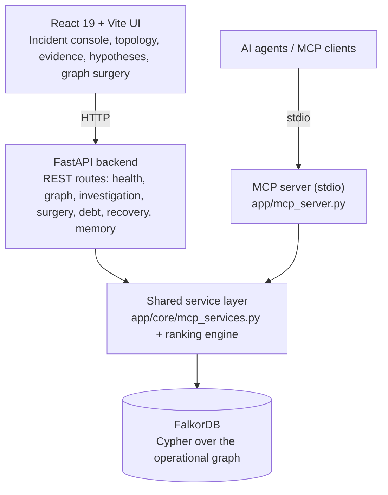

# TraceForge

**Graph-powered incident investigation, evidence-backed hypotheses, and safe counterfactual simulation.**

TraceForge is an incident investigation command center built on **FalkorDB**. It models services, dependencies, deployments, alerts, metrics, runbooks, and investigation evidence as a property graph, then uses Cypher traversals to trace failure paths, measure blast radius, rank competing root-cause hypotheses, and test "what if" interventions on an isolated copy of the graph.

Built for **WeMakeDevs × FalkorDB Graph Hacks 2026**.

[Live Demo](https://trace-forge-seven.vercel.app/) · [Backend API](https://traceforge-backend-6rtl.onrender.com/) · [Demo Video](<DEMO_VIDEO_URL>) · [Technical Blog](<https://builder.aws.com/content/3KsNfutBPWj6TEccCCFmqBwlBn4/traceforge-building-a-graph-powered-incident-investigation-command-center-with-falkordb>)

---

## The Problem

When an incident hits a system of interconnected services, engineers have to correlate alerts, metrics, recent deployments, and dependency relationships by hand. Dashboards show isolated signals; the *relationships* between them are what explain a failure.

TraceForge makes those relationships the core of the investigation. Every hypothesis is tied to evidence in the graph, every blast-radius figure comes from a real traversal, and every proposed intervention can be simulated before anyone acts on it.

## Key Features

- **Dependency tracing**: bounded, directed traversal of `DEPENDS_ON` paths between services.
- **Blast-radius analysis**: finds every downstream service that depends (directly or transitively) on a failing component.
- **Incident evidence inspection**: aggregates affected services, alerts, correlated metric anomalies (with sigma deviation), candidate deployments, and evidence debt.
- **Evidence-backed hypothesis ranking**: a deterministic multi-factor scoring engine ranks competing root-cause hypotheses using supporting and contradicting evidence. It can abstain when evidence is insufficient.
- **Graph surgery (counterfactual simulation)**: apply a hypothetical change to an isolated clone of the graph and compare blast radius and hypothesis rankings against the baseline.
- **MCP server**: five deterministic investigation tools exposed over the Model Context Protocol so AI agents can query the operational graph.
- **Optional LLM verification**: Gemini or OpenAI can be configured; without a key, TraceForge falls back to deterministic heuristic scoring and still works.

## Architecture



The REST API and the MCP server are two entry points into the **same** service layer, so a human using the UI and an agent using MCP see consistent results.

## Technology Stack

| Layer | Technology |
| :--- | :--- |
| Frontend | React 19, TypeScript, Vite, Tailwind CSS v4 |
| Backend API | Python 3.11+, FastAPI, Pydantic v2 |
| Graph database | FalkorDB (`falkordb` Python client over the Redis wire protocol) |
| Agent integration | Model Context Protocol (`mcp` package, stdio transport) |
| Optional LLM | Gemini or OpenAI, with deterministic fallback |
| Containers | Docker, Docker Compose (FalkorDB + backend + Nginx-served frontend) |
| Deployment | Vercel (frontend), Render (backend) |

## How It Works

1. **Investigate**: select an incident. TraceForge pulls its affected services, alerts, correlated metric observations, deployments, applicable runbooks, and similar historical incidents from the graph.
2. **Trace dependencies**: traverse `DEPENDS_ON` edges upstream (what a service relies on) or downstream (what relies on it).
3. **Examine evidence**: separate directly observed facts from conclusions inferred through topology. Missing or uncataloged relationships surface as *evidence debt*.
4. **Compare hypotheses**: candidates are scored on supporting and contradicting evidence, causal paths, and change risk. Rankings are candidates for human review, not proven root causes.
5. **Simulate an intervention**: run a hypothetical change on an isolated copy of the graph and compare the outcome against the baseline.

## Graph Data Model

All of the following is taken from the implementation (`backend/app/db/seed.py`, `queries.py`, `investigation.py`, `surgery.py`, `recovery.py`, `debt.py`).

### Node labels

**Seeded and indexed (12):**

| Label | Key properties |
| :--- | :--- |
| `Service` | `id`, `name`, `tier`, `team`, `language`, `repository`, `status`, `created_at` |
| `Incident` | `id`, `title`, `severity`, `status`, `started_at`, `resolved_at`, `summary` |
| `Alert` | `id`, `name`, `severity`, `source`, `timestamp`, `description`, `metric_name`, `value` |
| `Deployment` | `id`, `version`, `commit_sha`, `deployed_at`, `author`, `status`, `environment` |
| `MetricObservation` | `id`, `metric_name`, `timestamp`, `value`, `baseline`, `deviation_sigma`, `unit` |
| `Runbook` | `id`, `title`, `version`, `url` |
| `RunbookStep` | `id`, `step_number`, `action`, `command`, `estimated_time_mins` |
| `Investigation` | `id`, `status`, `started_at`, `lead_agent`, `ranked_at`, `abstained` |
| `Hypothesis` | `id`, `statement`, `confidence`, `status`, `title`, `score`, `rank`, `verdict` |
| `Evidence` | `id`, `type`, `description`, `confidence` |
| `RecoveryAction` | `id`, `action_type`, `status`, `executed_at` |
| `Approval` | `id`, `approver`, `role`, `status`, `decided_at` |

**Written dynamically at runtime:** `RecoveryProposal`, `EvidenceDebt`, `SimulationResult`.

### Relationships

| Relationship | Pattern | Properties |
| :--- | :--- | :--- |
| `DEPENDS_ON` | `(:Service)-[:DEPENDS_ON]->(:Service)` | `protocol`, `timeout_ms`, `critical` |
| `AFFECTS` | `(:Incident)-[:AFFECTS]->(:Service)` | |
| `PRODUCES_ALERT` | `(:Service)-[:PRODUCES_ALERT]->(:Alert)` | |
| `CORRELATES_WITH` | `(:Alert)-[:CORRELATES_WITH]->(:MetricObservation)` | |
| `DEPLOYED_TO` | `(:Deployment)-[:DEPLOYED_TO]->(:Service)` | `strategy` |
| `APPLIES_TO` | `(:Runbook)-[:APPLIES_TO]->(:Service)` | |
| `HAS_STEP` | `(:Runbook)-[:HAS_STEP]->(:RunbookStep)` | `sequence` |
| `INVESTIGATES` | `(:Investigation)-[:INVESTIGATES]->(:Incident)` | |
| `EXPLORES_HYPOTHESIS` | `(:Investigation)-[:EXPLORES_HYPOTHESIS]->(:Hypothesis)` | |
| `HAS_EVIDENCE` | `(:Investigation)-[:HAS_EVIDENCE]->(:Evidence)` | |
| `SUPPORTS` | `(:Hypothesis)-[:SUPPORTS]->(:Evidence)` | `weight` |
| `CONTRADICTS` | `(:Hypothesis)-[:CONTRADICTS]->(:Evidence)` | `weight` |
| `RESOLVED_BY` | `(:Incident)-[:RESOLVED_BY]->(:RecoveryAction)` | |
| `TARGETS` | `(:RecoveryAction \| :RecoveryProposal)-[:TARGETS]->(:Service)` | |
| `REQUIRES` | `(:RecoveryAction)-[:REQUIRES]->(:Approval)` | |
| `PROPOSES_RECOVERY` | `(:Incident)-[:PROPOSES_RECOVERY]->(:RecoveryProposal)` | |
| `HAS_EVIDENCE_DEBT` | `(:Incident)-[:HAS_EVIDENCE_DEBT]->(:EvidenceDebt)` | |
| `RESULTED_IN` | `(:RecoveryProposal)-[:RESULTED_IN]->(:SimulationResult)` | |

> **Direction matters.** `DEPENDS_ON` points from the *dependent* (caller) to its *dependency*, e.g. `(checkout-orchestrator)-[:DEPENDS_ON]->(payment-core)`.
> - **Upstream** (what a service relies on): `(root)-[:DEPENDS_ON*]->(target)`
> - **Downstream blast radius** (what breaks if it fails): `(dependent)-[:DEPENDS_ON*]->(root)`

### Indexes

`create_graph_schema_indexes` creates a secondary index on `id` for each of the 12 seeded labels:

```cypher
CREATE INDEX FOR (n:Service) ON (n.id)
CREATE INDEX FOR (n:Incident) ON (n.id)
-- ...and the same for Alert, Deployment, MetricObservation, Runbook,
-- RunbookStep, Evidence, Hypothesis, Investigation, RecoveryAction, Approval
```

No uniqueness constraints are defined. Idempotent seeding relies on `MERGE` over the indexed `id` property.

### Cypher queries from the implementation

**Upstream dependency traversal** (`backend/app/db/queries.py`, `traverse_dependencies`). Depth is clamped to 1 to 5 in Python and interpolated into the pattern.

```cypher
MATCH path = (root:Service {id: $service_id})-[:DEPENDS_ON*1..{clamped_depth}]->(target:Service)
UNWIND nodes(path) AS n
UNWIND relationships(path) AS r
RETURN collect(DISTINCT {id: n.id, name: n.name, tier: n.tier, team: n.team, status: n.status}) AS nodes,
       collect(DISTINCT {source: startNode(r).id, target: endNode(r).id,
                         type: type(r), protocol: r.protocol}) AS edges
```

**Downstream blast radius** (`backend/app/db/queries.py`, `find_downstream_dependents`):

```cypher
MATCH path = (dependent:Service)-[:DEPENDS_ON*1..{clamped_depth}]->(root:Service {id: $service_id})
UNWIND nodes(path) AS n
UNWIND relationships(path) AS r
RETURN collect(DISTINCT {id: n.id, name: n.name, tier: n.tier, team: n.team, status: n.status}) AS nodes,
       collect(DISTINCT {source: startNode(r).id, target: endNode(r).id, type: type(r)}) AS edges
```

**Candidate deployment correlation** (`backend/app/db/investigation.py`, `build_investigation_context`):

```cypher
MATCH (d:Deployment)-[r:DEPLOYED_TO]->(s:Service)
WHERE s.id IN $service_ids
RETURN d.id AS id, s.id AS service_id, s.name AS service_name,
       d.version AS version, d.commit_sha AS commit_sha, d.deployed_at AS deployed_at,
       d.author AS author, d.status AS status, d.environment AS environment,
       r.strategy AS strategy
ORDER BY d.deployed_at DESC
LIMIT 20
```

**Incident telemetry** (`backend/app/db/investigation.py`, `get_incident_alerts_and_metrics`), shortened here to its traversal shape; the full query also projects each property:

```cypher
MATCH (inc:Incident {id: $incident_id})
OPTIONAL MATCH (inc)-[:AFFECTS]->(s:Service)
OPTIONAL MATCH (s)-[:PRODUCES_ALERT]->(a:Alert)
OPTIONAL MATCH (a)-[:CORRELATES_WITH]->(m:MetricObservation)
RETURN inc, collect(DISTINCT s) AS services,
       collect(DISTINCT a) AS alerts, collect(DISTINCT m) AS metrics
```

## Graph Surgery: How Simulation Works

Implemented in `backend/app/db/surgery.py`. Supported actions:

| Action | Effect on the cloned graph |
| :--- | :--- |
| `remove_dependency` | Deletes a directed `(Service)-[:DEPENDS_ON]->(Service)` edge |
| `isolate_service` | Deletes all incoming and outgoing `DEPENDS_ON` edges of a service |
| `rollback_deployment` | Deletes the `(Deployment)-[:DEPLOYED_TO]->(Service)` edge |
| `remove_evidence` | `DETACH DELETE`s an `Evidence` node to test how stable a hypothesis is without it |

Execution path:

1. The baseline graph is copied to a temporary graph with FalkorDB's native copy (`traceforge_exp_<id>`).
2. The deletion runs **only on the copy**; the baseline graph is never mutated.
3. The same ranking engine runs on both graphs, and TraceForge reports the diffs: score deltas, factor contribution shifts, blast-radius change, and whether the causal path is severed.
4. The temporary graph is deleted afterwards (`exp_graph.delete()`) unless `preserve_experiment_graph=True` is requested. A guard prevents the baseline graph from ever being deleted.

> **Safety boundary:** simulations run against a copy of the graph data inside FalkorDB. They do not change the baseline graph and do not execute anything against real infrastructure. Results describe the supplied graph and evidence, not a verified outcome in a live system.

## MCP Server

TraceForge ships an MCP server (`backend/app/mcp_server.py`, stdio transport) that exposes five tools backed by the same service layer as the REST API:

| Tool | Parameters | What it does |
| :--- | :--- | :--- |
| `trace_dependency_path` | `source_service_id`, `target_service_id`, `max_depth=3` | Finds the directed dependency path between two services (depth 1 to 5) |
| `get_blast_radius` | `service_id`, `max_depth=3` | Computes downstream services affected if the given service fails |
| `inspect_incident_evidence` | `incident_id`, `max_depth=3` | Returns correlated alerts, metric anomalies, deployments, and evidence debt |
| `compare_hypotheses` | `incident_id`, `max_depth=3` | Ranks competing root-cause hypotheses with deterministic multi-factor scoring |
| `simulate_graph_intervention` | `incident_id`, `action_type`, `source_id`, `target_id` (optional), `relationship_type`, `justification` | Runs graph surgery on an isolated clone and returns causal-shift and blast-radius diffs |

Run it from the repository root (after the backend setup below):

```bash
# macOS / Linux
export PYTHONPATH="backend"
python3 -m app.mcp_server
```

```powershell
# Windows PowerShell
$env:PYTHONPATH = "backend"
python -m app.mcp_server
```

See [`docs/MCP_SERVER.md`](docs/MCP_SERVER.md) for client configuration details and the agent guide.

## Demo Dataset

The seeded dataset is a **synthetic** operational graph for a fictional payments company, **NexusPay**:

- 20 microservices across 5 tiers (edge, core, internal workers, storage/infra, external gateways) with 20 `DEPENDS_ON` edges
- 4 deployments, including the true culprit `DEP-4012` on `payment-core` and a misleading red-herring canary `DEP-4011` on `auth-service`
- 3 scenarios: active SEV1 `INC-2026-8821`, historical resolved SEV2 `INC-2026-7104`, and a sparse low-evidence SEV3 `INC-2026-9043`
- Metric anomalies (for example a connection pool at 100/100 with a 5.8 sigma deviation), runbooks with concrete steps, and approval records
- An intentionally missing edge, `risk-scoring-engine -> merchant-config-service`, to simulate uncataloged dependency debt

## Screenshots

| Incident Command Center | Dependency Explorer |
| :--- | :--- |
|  |  |
| **Evidence & Hypotheses** | **Graph Surgery** |
|  |  |
| **Agent Trace (MCP)** | **Data Model** |
|  |  |


## Getting Started

### Prerequisites

| Tool | Requirement |
| :--- | :--- |
| Python | 3.11 or newer |
| Node.js | 20 or newer, with npm |
| Docker | Optional: Docker Engine 20.10+ / Compose v2 for FalkorDB or the full stack |
| FalkorDB | Local via Docker, or a hosted FalkorDB Cloud instance |

### Option A: Full stack with Docker Compose

```bash
git clone https://github.com/rajputpranav611-byte/trace-forge.git
cd trace-forge
cp .env.example .env

docker compose up --build
```

Compose starts FalkorDB (`6379`, browser UI on `3000`), the FastAPI backend (`8000`), and the frontend served by Nginx (`5173`). Seeding is **not** part of container startup, so load the demo graph once:

```bash
docker exec -it traceforge-backend python -m app.db.seed
```

Then open <http://localhost:5173>.

### Option B: Local development

**1. Clone and configure**

```bash
git clone https://github.com/rajputpranav611-byte/trace-forge.git
cd trace-forge
cp .env.example .env        # PowerShell: Copy-Item .env.example .env
```

**2. Start FalkorDB**

```bash
docker run --name traceforge-db -d -p 6379:6379 -p 3000:3000 falkordb/falkordb:latest
```

To use a hosted FalkorDB Cloud instance instead, set `FALKORDB_HOST`, `FALKORDB_PORT`, `FALKORDB_USERNAME`, `FALKORDB_PASSWORD`, and `FALKORDB_SSL=true` in `.env`.

**3. Backend** (run everything from the repository root so `.env` is found)

macOS / Linux:

```bash
python3 -m venv .venv
source .venv/bin/activate
pip install -r backend/requirements.txt

export PYTHONPATH="backend"
python3 -m app.db.seed                                             # load the NexusPay graph
python3 -m uvicorn app.main:app --host 0.0.0.0 --port 8000 --reload
```

Windows PowerShell:

```powershell
python -m venv .venv
.\.venv\Scripts\Activate.ps1
pip install -r backend/requirements.txt

$env:PYTHONPATH = "backend"
python -m app.db.seed
python -m uvicorn app.main:app --host 0.0.0.0 --port 8000 --reload
```

`PYTHONPATH=backend` is required; without it Python raises `ModuleNotFoundError: No module named 'app'`.

**4. Frontend** (second terminal)

```bash
cd frontend
npm install
npm run dev
```

Open <http://localhost:5173>. The frontend calls `http://localhost:8000` by default.

**5. Run the tests (optional)**

```bash
export PYTHONPATH="backend"      # PowerShell: $env:PYTHONPATH = "backend"
pytest backend/tests -v
```

### Environment variables

Defined in `backend/app/core/config.py` (backend) and `frontend/src/App.tsx` (frontend). All have defaults; none of the secret values are committed.

| Variable | Used by | Required | Default / example |
| :--- | :--- | :--- | :--- |
| `FALKORDB_HOST` | Backend | Yes | `localhost` |
| `FALKORDB_PORT` | Backend | Yes | `6379` |
| `FALKORDB_GRAPH_NAME` | Backend | No | `traceforge` |
| `FALKORDB_USERNAME` | Backend | No | empty (local) |
| `FALKORDB_PASSWORD` | Backend | No | empty (local) |
| `FALKORDB_SSL` | Backend | No | `false` |
| `BACKEND_HOST` | Backend | No | `0.0.0.0` |
| `BACKEND_PORT` | Backend | No | `8000` |
| `ENVIRONMENT` | Backend | No | `development` |
| `CORS_ORIGINS` | Backend | No | `http://localhost:5173,http://localhost:3000` |
| `LLM_PROVIDER` | Backend | No | `auto` (`gemini`, `openai`, `mock`) |
| `GEMINI_API_KEY` | Backend | No | empty (falls back to deterministic scoring) |
| `OPENAI_API_KEY` | Backend | No | empty (falls back to deterministic scoring) |
| `LLM_MODEL` | Backend | No | `gemini-1.5-flash` |
| `LLM_TIMEOUT_SECONDS` | Backend | No | `8.0` |
| `VITE_API_BASE_URL` | Frontend | No | `http://localhost:8000` |

To point the frontend at a different backend, create `frontend/.env` with `VITE_API_BASE_URL=<backend url>`.

## Project Structure

```
trace-forge/
├── backend/
│   ├── Dockerfile
│   ├── requirements.txt
│   ├── app/
│   │   ├── main.py              # FastAPI app and DB lifespan
│   │   ├── mcp_server.py        # MCP stdio server (5 tools)
│   │   ├── api/routes/          # REST routes
│   │   ├── core/                # config, shared services, ranking engine, LLM verifier
│   │   ├── db/                  # client, queries, seed, investigation, surgery, debt, recovery, memory
│   │   └── schemas/             # Pydantic v2 schemas
│   └── tests/                   # pytest suite
├── frontend/                    # React 19 + Vite + Tailwind CSS v4
├── docs/
│   └── MCP_SERVER.md
├── docker-compose.yml
├── .env.example
└── README.md
```

## Deployment

- Frontend (Vercel): <https://trace-forge-seven.vercel.app/>
- Backend (Render): <https://traceforge-backend-6rtl.onrender.com/>
- Source: <https://github.com/rajputpranav611-byte/trace-forge>

The backend is an API service, so its bare root URL is not a web page. The deployments are separate, and the live demo depends on the backend and its FalkorDB connection being available.

## Responsible Use and Limitations

- TraceForge supports investigation; it does not guarantee a correct root-cause diagnosis.
- Hypothesis rankings are candidates for human review, not proof of causality.
- Results depend on the completeness of the topology and evidence in the graph, and uncataloged dependencies will not appear in blast-radius results.
- The demo uses synthetic scenario data, not live production telemetry.
- Simulations modify only a temporary copy of the graph; they are not real infrastructure changes.
- Validate any operational change through normal engineering review and production safeguards.

## Hackathon

**Event:** WeMakeDevs × FalkorDB Graph Hacks 2026, *Context for AI Agents*
**Track:** Track 01, Agents That Act on Connected Data

TraceForge explores how a graph database gives AI-assisted operational investigations structured context, traceable relationships, and inspectable evidence.

## AI Assistance Disclosure

AI coding assistants were used during development to support implementation, debugging, and documentation. The project should be evaluated against the source code and the working demo. The author remains responsible for understanding, validating, and explaining the submitted implementation.

## Acknowledgements

Thanks to the FalkorDB and WeMakeDevs communities for creating a space to explore graph-powered AI applications.
