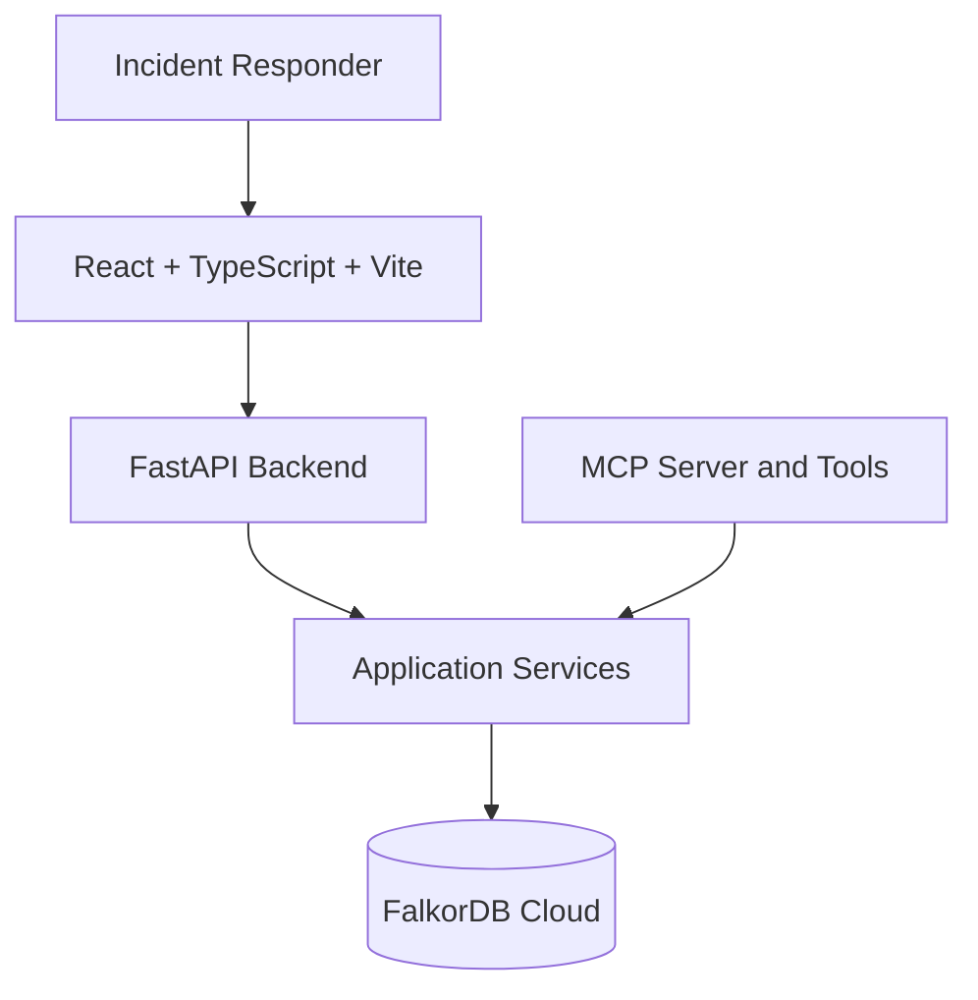
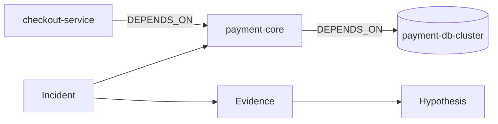

# TraceForge
### Operational Incident Response & Topology Command Center

**An AI-powered incident investigation platform that uses graph-connected context to trace dependencies, examine evidence, compare hypotheses, and simulate safer recovery decisions.**

<p align="center">
  <a href="https://trace-forge-seven.vercel.app/"><strong>🚀 Live Application</strong></a>
  ·
  <a href="https://traceforge-backend-6rtl.onrender.com/"><strong>⚙️ Backend API</strong></a>
  ·
  <a href="#architecture"><strong>🏗️ Architecture</strong></a>
</p>

<!-- Replace with your actual screenshots. See the Screenshots section below. -->
<p align="center">


</p>

## Overview

When a production incident occurs, engineers need more than an alert or a list of logs. They need to understand how services depend on one another, which components may be affected, what evidence supports competing explanations, and what could happen if a dependency or recovery action changes.

**TraceForge turns incident investigation into a graph-grounded workflow.**

Instead of treating every service, incident, alert, and hypothesis as an isolated record, TraceForge represents their relationships in FalkorDB. Its backend exposes graph operations through application services and MCP tools so an AI agent can gather relevant context and support explainable investigation.

TraceForge is designed to distinguish three things:

- **Observed:** Data and evidence represented in the available graph.
- **Inferred:** Hypotheses or conclusions derived from that evidence.
- **Simulated:** Counterfactual outcomes produced by a graph intervention.

A simulated outcome is not proof that the same result will occur in production.

## Live deployment

| Component | URL |
|---|---|
| Frontend | https://trace-forge-seven.vercel.app |
| Backend | https://traceforge-backend-6rtl.onrender.com|
| API documentation | https://traceforge-backend-6rtl.onrender.com |

The API documentation URL assumes FastAPI's default Swagger route is enabled. If your application uses a different configuration, replace it with the actual documentation route.

The backend's root URL does not necessarily serve a homepage. Use the application's configured health and API endpoints to verify backend availability.

## The problem

Incident responders often need to answer questions such as:

- Which services are downstream of a failing dependency?
- What is the potential blast radius of a service failure?
- Which hypothesis is best supported by the available evidence?
- What changes when a dependency is removed in an isolated simulation?
- Can an investigation explain why it reached a conclusion?

These questions depend on **relationships between entities**, not merely on individual records.

TraceForge uses FalkorDB to represent those relationships explicitly and retrieve connected context for incident investigation.

## Key capabilities

### 1. Incident Command Center
A central workspace for inspecting incident context and navigating the investigation workflow.

### 2. Dependency Explorer
Explore service relationships and dependency paths to understand how components connect and where failures may propagate.

### 3. Hypothesis & Evidence Lab
Inspect incident evidence and compare competing explanations. Keep evidence distinct from interpretations so that an attractive hypothesis is not mistaken for a proven cause.

### 4. Graph Surgery Workspace
Explore counterfactual dependency changes and their potential effect on the graph. Treat results as simulations, not guaranteed production outcomes.

### 5. Safe Recovery Console
Support recovery decision-making with graph-grounded context and explicit separation between analysis and action.

### 6. Memory & Evidence Debt
Surface gaps in investigation context and evidence so that uncertainty is visible rather than hidden behind a confident-looking answer.

> Verify each capability against the deployed build before submission. Remove or revise any description that is not supported by the current implementation.

## Architecture


TraceForge uses a frontend/backend architecture with FalkorDB as its graph context layer.



### Components

| Component | Responsibility |
|---|---|
| React, TypeScript, Vite | Incident investigation interface and graph exploration |
| FastAPI | Backend API and application orchestration |
| Application services | Investigation logic, evidence retrieval, graph operations and simulation workflows |
| MCP tools | Structured access to graph-backed investigation capabilities |
| FalkorDB | Connected service topology, incident context, evidence and graph queries |
| Render | Backend hosting |
| Vercel | Frontend hosting |

The frontend communicates with the backend; it should not connect directly to FalkorDB or contain database credentials.

## Graph data model

The graph models a synthetic payment-platform environment called **NexusPay**. Its purpose is to support incident investigation without requiring private production data.

The following is a conceptual model. Confirm the actual labels, properties, and relationship names against the seed code before treating it as the exact implemented schema.

### Entity types

| Entity | Purpose |
|---|---|
| `Service` | An application or infrastructure component |
| `Incident` | An operational event requiring investigation |
| `Alert` | A signal associated with an incident or service |
| `Metric` | An observed measurement or operational signal |
| `Hypothesis` | A proposed explanation for an incident |
| `Evidence` | Information supporting or weakening a hypothesis |
| `Deployment` | A change that may be relevant to an incident |
| `Runbook` | Operational guidance associated with a service or incident |
| `Investigation` | The context and progress of an incident investigation |

### Relationship types

Examples of relationships the graph model may represent include:

- `DEPENDS_ON` — one service depends on another.
- Incident-to-service relationships — services affected by or associated with an incident.
- Incident-to-alert relationships — alerts associated with an incident.
- Hypothesis-to-evidence relationships — evidence relevant to a proposed explanation.
- Deployment-to-service relationships — changes associated with a service.
- Service-to-runbook relationships — operational procedures relevant to a component.

Use the exact relationship types from `backend/app/db/seed.py` and `backend/app/db/queries.py` in the final version.

### Example topology



This is an illustrative topology, not a claim about the complete live graph.

## How the agent uses the graph

The investigation workflow is designed around structured tools rather than allowing an AI model to invent arbitrary database operations.

1. **Understand the incident:** identify the incident and relevant entities.
2. **Retrieve connected context:** follow dependency paths and examine relevant evidence.
3. **Evaluate explanations:** compare hypotheses against the available context.
4. **Explore potential impact:** calculate the relevant blast radius.
5. **Simulate a proposed change:** evaluate an intervention in an isolated simulation context.
6. **Present an explainable result:** distinguish retrieved facts, inferred explanations, and simulated outcomes.

The graph is valuable because relationships can be traversed directly. Removing the graph layer would remove important dependency reasoning from the investigation workflow.

## MCP tools

TraceForge's MCP implementation is intended to expose structured graph-backed operations to an AI agent.

| Tool | Purpose |
|---|---|
| `trace_dependency_path` | Trace relationships between relevant entities |
| `get_blast_radius` | Inspect the potential impact of a service or dependency |
| `inspect_incident_evidence` | Retrieve evidence relevant to an investigation |
| `compare_hypotheses` | Compare candidate explanations |
| `simulate_graph_intervention` | Explore a graph change in a simulation context |

Tool names and arguments should be checked against `backend/app/mcp_server.py` and `backend/app/core/mcp_services.py`.

**Safety principle:** investigation and simulation should not silently mutate the baseline topology. Clearly identify the assumptions and limitations of counterfactual results.

## Graph queries

TraceForge uses Cypher-style graph queries through FalkorDB. The following examples illustrate the types of traversals the data model supports; validate them against your actual schema before presenting them as application queries.

### 1. Inspect direct service dependencies

```cypher
MATCH (s:Service {name: $service_name})-[:DEPENDS_ON]->(dependency)
RETURN s.name AS service, dependency.name AS dependency
```

### 2. Explore a dependency path

```cypher
MATCH p = (a:Service {name: $source})
          -[:DEPENDS_ON*1..5]->
          (b:Service {name: $target})
RETURN p
LIMIT 20
```

### 3. Inspect incident-linked evidence

```cypher
MATCH (i:Incident {id: $incident_id})-[r]-(related)
RETURN type(r) AS relationship, labels(related) AS entity_types, related
LIMIT 50
```

These are illustrative patterns, not verified copies of TraceForge's production queries. Adapt labels, properties, relationship direction, and parameters to the actual graph model.

## Technology stack

- **Frontend:** React, TypeScript, Vite
- **Backend:** Python, FastAPI
- **Graph database:** FalkorDB
- **Agent interoperability:** Model Context Protocol (MCP)
- **Frontend deployment:** Vercel
- **Backend deployment:** Render

Add any additional libraries, AI model providers, or visualization libraries only if they are actually used in the submitted code.

## Getting started locally

### Prerequisites

- Git
- Node.js and npm
- Python compatible with the project's dependency files
- Access to a FalkorDB instance
- Any additional provider credentials required by your implementation

### 1. Clone the repository

```bash
git clone <YOUR_PUBLIC_GITHUB_REPOSITORY_URL>
cd SessionSmith
```

Replace the placeholder with the public repository URL.

### 2. Configure the backend

Create a virtual environment:

```powershell
cd F:\SessionSmith
python -m venv .venv
.\.venv\Scripts\Activate.ps1
```

Install the backend dependencies using the dependency file present in your repository. For example, if the backend has its own `requirements.txt`:

```powershell
pip install -r backend\requirements.txt
```

If the dependency file is located elsewhere, use its actual path.

Copy `.env.example` to `.env` and fill in the values locally:

```env
FALKORDB_HOST=<your-falkordb-host>
FALKORDB_PORT=<your-falkordb-port>
FALKORDB_GRAPH_NAME=traceforge
FALKORDB_USERNAME=<your-username>
FALKORDB_PASSWORD=<your-password>
FALKORDB_SSL=false
```

The values above are examples based on the current development setup. Use the connection parameters provided by your own FalkorDB instance.

**Never commit `.env` or publish database credentials.** Keep `.env.example` populated with placeholders only.

### 3. Initialize the graph

Inspect the seed implementation and its instructions before running it. Confirm that the operation is safe and that it targets the intended graph.

Run the seed command documented by the project. Do not assume a particular entry point without checking `backend/app/db/seed.py` and the repository's setup instructions.

After seeding, verify that expected entities and relationships exist.

### 4. Start the backend

Set the backend import path if your application requires it:

```powershell
$env:PYTHONPATH = "F:\SessionSmith\backend"
```

Start FastAPI using the actual application entry point configured in your repository. For example, if the ASGI application is `app.main:app`:

```powershell
uvicorn app.main:app --reload --host 127.0.0.1 --port 8000
```

Replace `app.main:app` if your actual module or application variable differs.

### 5. Start the frontend

Open another terminal and navigate to the frontend directory containing `package.json`.

```bash
npm install
```

Create the frontend environment file required by the application and configure its API base URL. Use the exact environment variable name expected by the source code.

Then run:

```bash
npm run dev
```

Vite will display the local development URL in the terminal.

### 6. Verify the application

- Open the frontend.
- Confirm that the backend is reachable.
- Confirm that the graph has been seeded.
- Open an incident and inspect its connected context.
- Test dependency traversal and evidence retrieval.
- Test hypothesis comparison and graph simulation.
- Check browser and backend logs for errors.

## Testing

Run the test commands supported by the repository.

For example, if the backend uses pytest:

```powershell
$env:PYTHONPATH = "F:\SessionSmith\backend"
python -m pytest backend\tests -q
```

If the frontend defines test, type-check, or build scripts, run those too:

```bash
npm run build
```

Only report test counts or coverage numbers that you have actually measured.

## Screenshots

Create this directory in the repository:

```text
docs/
└── screenshots/
    ├── traceforge-dashboard.png
    ├── traceforge-dependency-graph.png
    ├── traceforge-evidence-lab.png
    ├── traceforge-graph-surgery.png
    └── traceforge-architecture.png
```

Capture screenshots of the real running application and save them with these names, or update the image links to match your filenames.

Recommended screenshots:

1. **Dashboard:** the incident command center and overall interface.
2. **Dependency graph:** visible service relationships and a meaningful traversal.
3. **Evidence lab:** a real incident with evidence and competing hypotheses.
4. **Graph surgery:** a real simulation, clearly labeled as simulated.
5. **Architecture:** a diagram showing the frontend, backend, MCP tools, and FalkorDB.

Use Markdown image links such as:

```markdown

```

Commit the image files to the public repository so the screenshots render on GitHub. Do not include credentials, private data, or misleading mock results.

## Deployment

### Frontend — Vercel

Live URL: https://trace-forge-seven.vercel.app

Configure the frontend project root, build command, and production API URL according to the repository's structure. Only expose public frontend configuration through Vite environment variables; never include database passwords or server-only secrets.

### Backend — Render

Live URL: https://traceforge-backend-6rtl.onrender.com

Configure the correct Python environment, dependency installation command, ASGI entry point, and Render port binding. Set FalkorDB credentials and other server-only secrets in Render's environment settings.

Verify the health endpoint, a real graph-backed API request, frontend-to-backend communication, and CORS configuration after deployment.

### Graph database — FalkorDB Cloud

The hosted graph stores the connected context used by the backend. Configure the database connection only in trusted backend environments. Do not connect the browser frontend directly to the database.

## Security and limitations

- Use public, synthetic, or otherwise authorized data.
- Keep database credentials and provider API keys out of Git.
- Validate tool inputs and restrict graph operations to intended capabilities.
- Separate read-only investigation from controlled graph modifications.
- Isolate graph simulations from the baseline data.
- Do not present hypotheses as confirmed root causes without supporting evidence.
- Do not treat simulated outcomes as guaranteed production results.
- Document any limitations of the hosted environment or model-generated conclusions.

## Hackathon information

**Event:** WeMakeDevs × FalkorDB — Graph Hacks: Context for AI Agents  
**Track:** Track 01 — Agents That Act on Connected Data  
**Project:** TraceForge

The project uses FalkorDB as the graph context layer for connected-data investigation and graph-backed agent tools.

Official rules: https://www.wemakedevs.org/hackathons/falkordb/rules

## Demo video

**Watch the demo:** `https://youtu.be/-Kc4a8znFeQ`

The video should demonstrate the working deployed product, the role of FalkorDB, actual agent tool usage, a meaningful dependency investigation, and the graph-surgery workflow.

## AI-assisted development disclosure

AI coding assistants were used as development aids for selected implementation, debugging, documentation, and workflow tasks. The project author is responsible for reviewing, testing, understanding, and explaining the submitted code and architecture.

Adjust this statement to accurately describe the tools used and your own contributions.

## Future improvements

Potential directions include:

- Richer provenance linking conclusions to their source evidence
- More incident scenarios and evaluation cases
- Stronger validation of graph interventions
- Investigation history and reproducible simulation comparisons
- More extensive automated tests and reliability evaluation

## License

Add a license that reflects the permissions you intend to grant. Do not claim an open-source license unless the corresponding license file is included in the repository.

