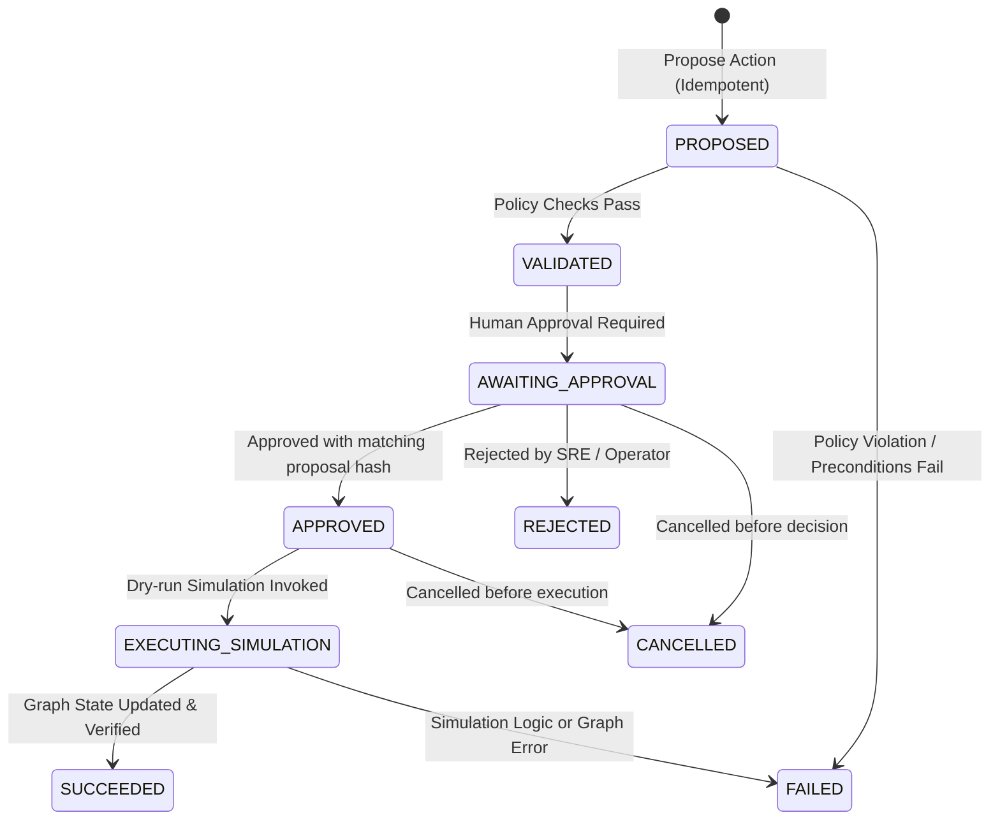
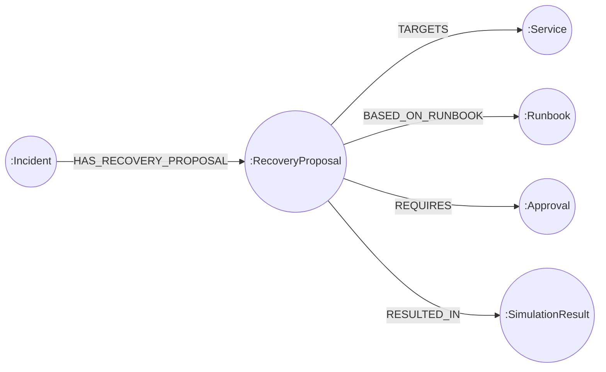

# TraceForge Safe Simulated Recovery Workflow Specification

## Overview

TraceForge provides a strictly bounded, non-destructive, simulated recovery workflow. It models real-world Site Reliability Engineering (SRE) mitigation steps (e.g. rollbacks, replica adjustments, circuit breakers) without issuing commands to live infrastructure.

Every state-changing recovery action requires cryptographic integrity verification, policy evaluation, and recorded human approval.

---

## 1. Supported State Machine

The recovery lifecycle progresses through the following finite states:

### State Definitions
1. **`PROPOSED`**: Action proposal received and stored in FalkorDB with a unique `idempotency_key` and cryptographic `proposal_hash`.
2. **`VALIDATED`**: Pre-execution policies and precondition rules verified successfully against graph state.
3. **`AWAITING_APPROVAL`**: Awaiting an explicit human approval decision. State-changing simulation cannot proceed without this.
4. **`APPROVED`**: Human operator granted approval. Cryptographic proposal hash was verified against the stored proposal.
5. **`REJECTED`**: Human operator rejected the proposal. The proposal cannot be executed.
6. **`EXECUTING_SIMULATION`**: Transient state while the dry-run simulation engine models post-mitigation state in FalkorDB.
7. **`SUCCEEDED`**: Simulation finished cleanly; non-destructive graph updates and audit trail recorded.
8. **`FAILED`**: Policy violation, precondition missing, or execution error occurred.
9. **`CANCELLED`**: Proposal revoked by operator prior to simulation execution.

---

## 2. Pre-Execution Policy Verifications

Before any action is permitted to transition to `VALIDATED` or execute:

1. **Allowlisted Action Type**:
   - `rollback_deployment`
   - `restart_service`
   - `scale_replicas`
   - `drain_connections`
   - `toggle_circuit_breaker`
   - `isolate_cluster`
2. **Target Service Exists**:
   - Verified via FalkorDB Cypher: `MATCH (s:Service {id: $target_service_id}) RETURN s`
3. **Required Evidence Exists**:
   - Every `required_evidence_ids` item is confirmed in the graph.
4. **Runbook Prerequisites Satisfied**:
   - If `runbook_id` is supplied, checks for prerequisite runbook steps (e.g. `STP-01` triage before `STP-02` rollback).
5. **Valid Proposed Scope**:
   - `rollback_deployment` must specify `target_revision` or valid parameters.
   - `scale_replicas` must have `replicas >= 1`.
6. **Blast-Radius Policy Satisfied**:
   - Multi-hop downstream dependent traversal `(s)-[:DEPENDS_ON*1..4]->(downstream:Service)`.
   - Maximum allowed downstream blast radius is $\le 8$ dependent services.
7. **Approval Matches Exact Proposal**:
   - SHA-256 integrity hash is recalculated upon approval submission:
     $$\text{SHA256}(incident\_id : action\_type : target\_service\_id : parameters : justification)$$
   - Rejects approval if proposal was altered after submission.
8. **Proposal Has Not Changed After Approval**:
   - Re-verified before executing simulation.
9. **Action Has Not Already Executed**:
   - Checked via idempotency token and state: prevents double-execution on network retries.

---

## 3. Idempotency Mechanism

Every proposal submission accepts an optional `idempotency_key` (generated as UUID if omitted).
If a request is repeated with the same `idempotency_key`:
- The existing proposal node is retrieved from FalkorDB.
- Existing policy validation and approval state are returned.
- No duplicate proposal nodes or duplicate executions are created.

---

## 4. FalkorDB Graph Schema

Proposals, approvals, and simulated outcomes are stored directly in FalkorDB:

### Graph Node Properties:
- **`(:RecoveryProposal)`**: `id`, `action_type`, `state`, `proposal_hash`, `idempotency_key`, `created_at`, `parameters`, `justification`.
- **`(:Approval)`**: `id`, `approver`, `status`, `decided_at`, `notes`, `proposal_hash`.
- **`(:SimulationResult)`**: `id`, `executed_at`, `success`, `simulated_effects`, `audit_trail`.

---

## 5. Security & Safety Invariants

> [!IMPORTANT]
> **Zero Real Infrastructure Execution Guarantee**: TraceForge recovery actions are 100% simulated dry-runs. No SSH, Kubernetes API, cloud provider CLI, or real process signals are ever dispatched. All transitions are verified in the backend and reflected strictly within the FalkorDB operational graph.
